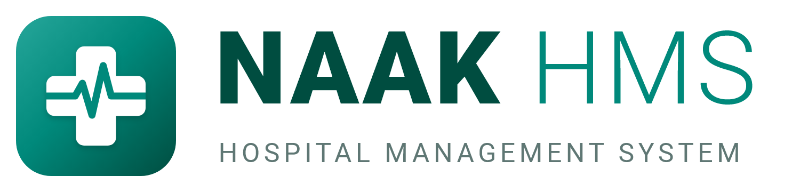
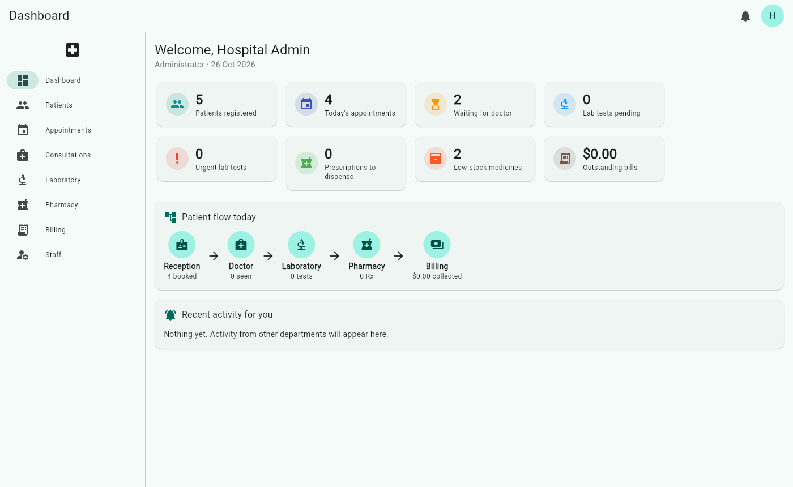

# NAAK HMS – Hospital Management System (Flutter)



A cross-platform Flutter app (Android, iOS, Web, Windows, macOS, Linux) that connects
**Reception, Emergency, Doctors, Laboratory, Radiology, Blood bank, Pharmacy, General
store, Wards, Operation Theatre, Billing, HR and Finance** in one workflow, with an optional
**Firebase backend** so every department's devices share the same live data.



## How the departments connect

```
Reception ──check-in──▶ Doctor queue ──order tests──▶ Laboratory queue
    │                       │    ▲                         │
    │                       │    └──── result + alert ─────┘
    │                       └──prescribe──▶ Pharmacy queue ──dispense──▶ stock deducted
    │                                                              │
    └──────────────── one invoice per visit ◀── consultation fee + lab tests + medicines
```

| Step | Who | What happens automatically |
|------|-----|----------------------------|
| Register / book / walk-in | Reception (counter or phone) / patient (online) | Patient gets an MRN; bookings must fit the doctor's free slots and queue reminders; online bookings notify reception; check-in assigns a queue token and notifies the doctor |
| Consultation | Doctor | Opens an invoice with the doctor's fee; records vitals, complaints, diagnosis, notes |
| Order lab tests | Doctor | Orders appear in the lab work queue (urgent first); tests are billed; lab is notified |
| Collect sample / enter result | Laboratory | Doctor is notified (abnormal results flagged); result shows in the consultation and patient record |
| Prescribe | Doctor | Prescription appears in the pharmacy queue, with live stock levels and allergy warnings |
| Dispense | Pharmacy | Stock is deducted (full or partial), dispensed items are billed, doctor is notified, low-stock alerts raised |
| Complete visit | Doctor | Appointment closed; optional follow-up appointment auto-booked |
| Admit | Reception / Doctor / Nurse | Patient gets a bed (capacity enforced); an admission invoice is opened; nurses and the doctor are notified |
| Transfer | Reception / Doctor / Nurse | New room stay starts; each room's days are billed at that room's rate |
| Discharge | Reception / Doctor / Nurse | Room charges (days × daily rate per stay, one-day minimum) are added to the bill |
| Schedule surgery | Doctor | Theatre double-booking is refused; surgeon and theatre nurses are notified |
| Complete surgery | Doctor / Nurse | Theatre time (started hours × hourly rate), surgeon fee, anaesthesia and consumables are billed to the admission, or a day-case bill |
| Emergency arrival | Reception / Nurse / Doctor | Patient (or an unidentified "Unknown male/female") goes on the emergency board; nurses are notified to triage |
| Triage | Nurse / Doctor | Five-level category with a see-by time; red and orange alert the doctors |
| See emergency patient | Doctor | Opens a consultation with the triage observations filled in, and bills the attendance fee |
| Request imaging | Doctor | Study goes to the radiology work list (urgent first) and is billed; radiology is notified |
| Report imaging | Radiology | Doctor is notified (abnormal flagged); report shows in the consultation and patient record |
| Request blood | Doctor | Blood bank is notified; the lab groups the patient, cross-matches compatible units and issues them, billing the admission |
| Requisition supplies | Any department | Store issues stock against it; billable items for a patient go on their bill |
| Payment | Reception / Pharmacy / Accounts | Consolidated bill split by department; method (cash, card, transfer, mobile money, insurance) and date recorded; discounts and part-payments |

Every patient has a single **medical record** showing visits, lab results, prescriptions,
admissions, surgeries and bills from all departments.

### Emergency department

*Emergency* is a live board of everyone in the department.

- **Arrival:** reception, a nurse or a doctor registers the patient, the complaint and how
  they arrived. Someone who can't give their details is registered as *Unknown male/female*
  with an estimated age, so treatment and billing can start; reception completes the record
  later.
- **Triage:** five categories (Red/Immediate, Orange/Very urgent 10 min, Yellow/Urgent 60 min,
  Green/Standard 120 min, Blue/Non-urgent 240 min) with temperature, pulse, respiratory rate,
  BP, SpO₂ and pain. The board sorts by category and marks patients waiting past their target
  as **overdue**. Red and orange alert the doctors. Patients can be re-triaged while waiting.
- **Doctor:** *See patient* opens an ordinary consultation with the triage observations filled
  in, so lab tests, imaging, blood and prescriptions work as in the clinic. The emergency
  attendance fee (set under *Hospital details*) goes on the same bill.
- **Disposition:** discharged, admitted (straight into a chosen ward under the treating
  doctor), referred, left without being seen, or died. Closing completes the consultation.
- The *Emergency attendances* report gives arrivals by category, waits against target and
  outcomes.

### Radiology

- Doctors request studies from the consultation (*Request imaging*), with urgency and clinical
  details. Each study is billed on the visit's invoice, like a lab test.
- Radiology's work list shows preparation instructions (e.g. fasting), lets them book a time,
  mark the study performed and write the report (findings, impression, abnormal flag).
  Cancelling a study not yet done removes its charge.
- The doctor is notified, marks the report reviewed, and the report prints with the letterhead.
- Radiographers maintain the examination catalogue (X-ray, ultrasound, CT, MRI, mammography...).

### Blood bank

Run by the laboratory, under *Blood bank*:

- **Donors** with blood group and donation history; a donor can give again 56 days after their
  last donation, or after a deferral ends. A donation becomes a numbered unit (`BU-00012`)
  that waits in quarantine until its infection screen passes; failures are discarded with the
  reason. Screened units can also be received from a blood service.
- **Stock** by group and component (whole blood, red cells, platelets, plasma, cryo), each with
  its shelf life; expired and soon-to-expire units are listed.
- **Requests:** doctors request blood from the consultation or the blood bank screen. The lab
  records the patient's group if unknown, then cross-matches: only usable units that are
  ABO/Rh compatible for that component can be reserved (same group offered first, then oldest
  stock). Issuing bills the units to the admission (or the visit) and prints an issue form with
  spaces for the bedside checks. Cancelling, or discarding a reserved unit, returns units to
  stock.

### General store

*General store* holds non-drug supplies: consumables, surgical supplies, linen, cleaning and
stationery.

- **Requisitions:** any department asks for supplies (optionally for a patient). The
  storekeeper issues them in full or in part, or rejects them; the requester can withdraw one
  that's still pending. Asking for more than is in stock fails without changing anything.
- **Billing:** items with a patient price that are issued for a patient go on their admission
  bill (*Medical supplies*).
- **Stock:** receiving deliveries (updating the cost), stock counts, low-stock alerts and a
  stock card for every item. The *General store* report gives stock value, issues by
  department and all movements.

### Doctor schedules and booking

Each doctor has weekly working hours (one or more sessions per weekday) and an appointment
length, edited under *Appointments → Doctor schedules* by the doctor or an administrator.
Booking then offers only the free slots: times outside working hours, slots already taken
and days on approved leave are refused, with a **Next available** shortcut. Approving
leave tells reception which booked appointments need moving, and **Reschedule** moves an
appointment and its reminders together. Walk-ins are always accepted, and doctors without
working hours can be booked at any time. Follow-ups booked at the end of a consultation take
the doctor's first free slot on or after the follow-up date.

### Booking at the counter, by phone and online

- **At the counter:** *Book at counter* for patients at reception, and *Walk-in* for those
  to be seen now.
- **By phone:** *Phone booking* looks the caller up by the number they're calling from, their
  name or MRN. A new caller is registered with that number filled in. Reception records who
  called (e.g. a parent) and can send an SMS confirmation straight away.
- **Online:** patients book through the patient portal (below).

Every appointment records its channel (counter, phone, online, walk-in or follow-up), who
took it and when. The day list shows this and can be filtered by channel. The dashboard
counts today's online bookings, and the *Appointments and booking channels* report breaks
the period down by channel, doctor and outcome.

### Patient portal

On the login screen, **Patients** opens the portal. In it, patients can:

- book a doctor's free slot online (at least 30 minutes ahead, at most 3 upcoming
  bookings, one per doctor a day), and get a confirmation and reminders;
- cancel a booking;
- see lab results once their doctor has reviewed them, and their prescriptions;
- see and print their bills and receipts;
- update their phone, email and address.

New patients can register themselves. Reception is notified of online registrations,
bookings and cancellations.

- **Local mode:** patients sign in with their MRN and date of birth (the login screen has a
  demo patient).
- **Firebase mode:** patients sign in with an email and password. They either register
  online or are given a login by reception (*patient record → key icon*).
  - A patient's device only ever receives their own records, plus working hours, taken
    slots (without names) and a doctor directory (names, specialities, fees and leave
    dates, but no staff records).
  - The security rules enforce this. They also refuse a second online booking of a taken
    slot, and registration can't claim an existing patient record.

### Appointment reminders

Every booking queues reminders (by default 24 h and 2 h before; set under *Hospital
details*) with a message template using `{patient}`, `{doctor}`, `{date}`, `{time}`,
`{hospital}`, `{phone}` and `{reason}`. They go by SMS when the patient has a phone
number (local numbers get the hospital's country code), otherwise by email. Rescheduling,
cancelling or checking in updates or withdraws them.

*Appointments → Reminders* lists the reminders due now, those scheduled for later, and the
history. Reception can send each one from the device's **SMS**, **WhatsApp** or **email**
app with the text filled in, then mark it sent, or skip it. To send SMS and WhatsApp
automatically, deploy the `sendDueReminders` Cloud Function (below) and turn on
*Send SMS/WhatsApp automatically*.

### Staff, payroll and finance

- **Staff directory**: role, designation, department, phone, joining date; staff who leave are
  marked inactive (login revoked, history kept). Support staff (cleaners, security…) are on the
  list and payroll without an app login.
- **Leave**: anyone can request leave from the account menu; administrators approve or decline.
- **Salaries & payroll**: basic, allowances and deductions per staff member. A monthly payroll run
  creates payslips, deducting approved unpaid leave pro rata; payslips are then marked paid.
- **Expenses**: categorised spending (supplies, utilities, rent, maintenance…).
- **Finance overview** per month: billed by department, collected by payment method, expenses
  by category, salaries paid, and net cash.
- Salaries, payslips and expenses are visible only to administrators and accounts (enforced by
  the Firestore rules, and never sent to other staff's devices).

### Payment over the counter

*Cashier* is the payment desk for reception, the pharmacy and accounts.

- **Opening the till:** each cashier opens their own till with the cash float in the drawer.
  Payments can only be taken while it is open.
- **Taking payment:** pick the patient from the list of people who owe money, or search for
  them. All their unpaid bills are shown, and one payment can cover several of them. It is
  applied to the oldest bill first, and a smaller amount is recorded as a part-payment.
- **Methods:**
  - **Cash:** the cashier enters the cash handed over, and the change to give is shown.
  - **Card, bank transfer and mobile money:** these need the slip or transaction reference.
  - **Insurance:** insurers pay through claims, not at the counter.
- **Receipts:** each payment gets a numbered receipt (`RCT-00001`), printed with the bills it
  covered, the cash handed over, the change given, and what is still owed.
- **Closing (cash-up):** the cashier counts the drawer. The app compares the count with the
  float plus cash taken and records any shortage or excess. Accounts are notified of a
  difference. Administrators and accounts can close a till someone forgot. A printable
  cash-up lists every payment in the till.
- **Reporting:** the *Collections* report includes receipt numbers, references and a
  per-till cash-up sheet. The dashboard shows the cash in your till.

**Refunds** (*Cashier → Refunds*):

- **Request:** a cashier picks the patient and the payment, enters the amount (up to what
  is left to refund on that payment), how it goes back (cash, card, transfer or mobile
  money) and the reason.
- **Approval:** administration or accounts approve or reject it, and are notified when a
  request comes in. An accountant can't approve their own request. Requests made by
  administration or accounts are approved at once.
- **Payout:** cash comes out of the cashier's open till, which must hold enough cash. Other
  methods need the reversal or transfer reference. The patient signs a numbered refund
  voucher (`RFD-00001`).
- **Accounting:** a paid refund is recorded as a negative payment on the bill. Till cash,
  the cash-up, collections and the finance overview all net it automatically, and the
  patient owes that amount again unless the charge was removed first.

**Day-end cash report** (*Cashier → Tills and cash-up*, any day): takings, refunds and net
by payment method, insurer settlements, every cashier's till (float, cash, expected,
counted, over/short), all refunds with who approved them, and a warning for tills still
open. It prints for sign-off by the preparer and accounts. The *Day-end cash* Excel report
gives the same figures day by day for any period, with a refunds sheet.

Payments recorded from an individual invoice also go into the cashier's open till. In
Firebase mode the rules only accept payments into the cashier's own open till, and only
accept a negative payment together with the approved refund it pays out, for the same
amount. Tills and refunds are visible to cashiers, administrators and accounts only.

### Insurance billing

- **Insurers** have a coverage percentage and an optional limit per bill. A patient's policy
  (insurer, member number, expiry) is applied automatically to every bill raised while it's
  valid, splitting it into an **insurer share** and a **patient share**; the front desk only
  collects the patient share.
- **Claims** go draft → submitted → approved/rejected → paid. Partial approval or rejection moves
  the shortfall to the patient. Inpatient claims wait for discharge so room charges are included.
  Insurer remittances are recorded as payments (method *Insurance*) and show in the finance
  reports; "due from insurers" is tracked separately from patient debt.

### Pharmacy purchasing

- **Suppliers** and **purchase orders** (draft → ordered → partly received → received). New orders
  can be pre-filled with every medicine at or below its reorder level.
- **Receiving goods** (in one or several deliveries) adds stock, records batch numbers, expiry
  dates and the supplier's delivery note, and updates each medicine's cost price.
- Accounts **pays the supplier** for what was delivered from Finance → Supplier bills, which
  records the expense automatically.

### Nursing care

Each admitted patient has a **nursing chart**:

- **Observations** (temperature, pulse, respiratory rate, BP, SpO₂, oxygen, consciousness, pain,
  glucose) with an automatic **NEWS2** early-warning score. A score of 5+ (or any single
  parameter scoring 3) alerts the patient's doctor; 5+ also alerts the nurses. The dashboard
  shows patients at risk.
- **Medication administration record**: doctors order ward medicines with a frequency, which
  sets the administration times; nurses record each dose as given, held, refused or missed (with
  a reason). Due and overdue doses are highlighted, and as-needed (PRN) doses are recorded with
  their time. Refused or held doses notify the doctor.
- **Nursing notes** by category (handover, wound care, fluid balance...).

Observations, doses and notes cannot be edited once saved (enforced by the Firestore rules).

### Audit log

Every change anyone saves is logged automatically: who, when, which record, and old → new values
for each changed field, plus sign-ins. Because entries are produced by comparing data before and
after each save, no action can be missed. Administrators can search and filter the log (by person,
action, date) and export it; in Firebase mode entries can't be edited or deleted, and other staff
can add entries in their own name but not read them. Passwords never appear in it. Local mode keeps
the most recent 5,000 entries.

### Excel reports

*Reports* exports `.xlsx` workbooks for any period (summary sheet first, then detail sheets with
frozen, filterable headers, real dates and money formats), each limited to the roles that need it:
collections, revenue by department and doctor, outstanding bills ageing, laboratory volumes and
turnaround, pharmacy stock value and usage, emergency attendances, radiology workload, blood
bank, general store, expenses, payroll register, insurance claims,
admissions and bed use, appointments by booking channel, day-end cash, patient register, and
the audit log.

### Printable documents

PDFs with the hospital's letterhead (set by the admin under *Hospital details*), printed or
saved through the system print dialog on every platform:
invoices/receipts (with insurance split and payments), payment receipts, insurance claim forms,
prescriptions, lab reports, imaging reports, blood issue forms, store requisitions, discharge
summaries, payslips and purchase orders.

## Roles & demo accounts

In local mode all demo passwords are `1234` (one-tap buttons on the login screen).
In Firebase mode, staff sign in with an email account created by the administrator.

| Username | Role | Access |
|----------|------|--------|
| `admin` | Administrator | Everything: staff, leave approval, room and theatre rates, finance, hospital details |
| `reception` | Reception | Patients, appointments, check-in, emergency arrivals, admissions, billing and cashier, insurance claims |
| `doctor`, `cardio`, `peds` | Doctors | Own queue, emergency patients, consultations, lab and imaging results, blood requests, admissions, surgery |
| `nurse` | Nurse | Emergency triage, wards, nursing charts (observations, medication rounds, notes), operation theatre |
| `lab` | Laboratory | Work queue, results, test catalogue, blood bank |
| `radiology` | Radiology | Imaging work list, booking, reports, examination catalogue |
| `pharmacy` | Pharmacy | Dispensing, inventory, suppliers, purchase orders, receiving goods, cashier |
| `stores` | General store | Requisitions, issuing, receiving, stock counts |
| `accounts` | Accounts | Billing, cashier and till cash-ups, insurance claims and insurers, expenses, supplier payments, payroll, finance |

Every staff member can raise store requisitions.
| *(patients)* | Patient portal | Own appointments (book online, cancel), reviewed results, prescriptions, bills, contact details |

## Running

```bash
flutter pub get
flutter run              # local mode: data stays on this device
flutter test             # workflow, multi-device sync and widget tests
```

## Firebase backend (multi-device sync)

With `--dart-define=USE_FIREBASE=true` the app stores everything in **Cloud Firestore** and
signs staff in with **Firebase Authentication**. A lab result entered on the lab's PC shows
up on the doctor's tablet within a second, stock dispensed at the pharmacy counter updates
every screen, and so on. Devices keep working offline and sync when the connection returns.

### One-time project setup

1. Create a project at <https://console.firebase.google.com>, then:
   - **Authentication → Sign-in method**: enable **Email/Password**.
   - **Firestore Database**: create a database.
2. Connect the app (generates `lib/firebase_options.dart`, replacing the placeholder):
   ```bash
   dart pub global activate flutterfire_cli
   flutterfire configure
   ```
3. Deploy the security rules:
   ```bash
   npm install -g firebase-tools
   firebase login
   firebase use --add            # pick your project
   firebase deploy --only firestore   # rules and indexes
   ```
4. Run with Firebase enabled:
   ```bash
   flutter run --dart-define=USE_FIREBASE=true
   flutter build web --dart-define=USE_FIREBASE=true   # or apk, windows, ...
   ```
5. On first launch choose **"First time? Set up a new hospital"**. This makes you the
   administrator (only possible once per project) and creates the lab-test catalogue and
   medicine list, plus optional demo patients and staff.
6. Optional, for automatic SMS/WhatsApp reminders (needs the Blaze plan and a
   [Twilio](https://www.twilio.com) account):
   ```bash
   firebase functions:secrets:set TWILIO_ACCOUNT_SID
   firebase functions:secrets:set TWILIO_AUTH_TOKEN
   firebase functions:secrets:set TWILIO_FROM            # your Twilio SMS number, +1...
   firebase functions:secrets:set TWILIO_WHATSAPP_FROM   # WhatsApp sender (same as TWILIO_FROM if unused)
   (cd functions && npm install)
   firebase deploy --only functions,firestore
   ```
   The function runs every 5 minutes, sends due reminders and records the result (sent, or
   failed with the error). It does nothing until *Send SMS/WhatsApp automatically* is
   turned on in *Hospital details*. Email reminders are always sent from the app.
7. Under **Staff**, use **Add staff** (or **Create login** on a demo staff member) to give
   each doctor, lab technician, pharmacist and receptionist an email and password.

### Local development with the emulators

No Firebase project is needed:

```bash
firebase emulators:start --only firestore,auth --project demo-hospital
flutter run -d chrome --dart-define=USE_FIREBASE=true \
  --dart-define=FIREBASE_EMULATOR_HOST=localhost       # 10.0.2.2 for the Android emulator
```

Security-rules tests run against the Firestore emulator:

```bash
cd firestore-tests && npm install && npm test
```

### How sync handles departments working at the same time

- Every record is its own Firestore document, and changes are written **field by field**,
  so the lab entering a result and the doctor marking another field on the same order
  don't overwrite each other.
- **Medicine stock** and **invoice payments** are written as atomic increments, so two
  pharmacists dispensing at once both get deducted.
- **Invoice lines** are separate documents, so the doctor's fee, lab tests and pharmacy
  charges can be added to the same bill from different devices at the same moment.
- **MRN, invoice and queue-token numbers** come from a shared counter updated in a
  transaction. Offline, a device falls back to a unique time-based number (e.g.
  `MRN-TL2X9QK`) rather than blocking registration.
- **Security rules** (`firestore.rules`) give each role write access only to its own
  department's records: reception registers patients, doctors order tests and prescribe,
  the lab results tests, the pharmacy changes stock, and only administrators manage staff.
  Accounts without a staff role can't read anything.

### Limitations

- Firebase mode runs on Android, iOS, macOS and web. FlutterFire's Windows support is meant
  for development, and Linux has no Firebase SDK, so use local mode there.
- Each device loads the whole hospital into memory. That's fine for a clinic or small
  hospital. A large hospital with years of records would need query-based loading (e.g.
  only today's queue and the open patient's history).
- The stock check happens on the dispensing device, so two devices dispensing the very
  last units at the same instant can take stock below zero. Neither deduction is lost.
- Removing a staff member revokes their access, but their Firebase Auth account remains.
  Delete it in the Firebase console, or add a Cloud Function using the Admin SDK.
- Staff accounts are created with the client SDK, so keep Email/Password sign-up enabled.
  Anyone can create an account in the project, but without a role it has no access.
- Online registration gives a patient a temporary-style number (`MRN-W…`), because a
  patient can't use the shared MRN sequence. Possible duplicates of existing patients
  aren't detected in Firebase mode, since the patient can't see other records, so
  reception should check new online registrations.
- The local-mode portal (MRN + date of birth on this device) suits a kiosk at the hospital.
  For a portal on the internet, use Firebase mode.

## Project structure

```
lib/
  main.dart                    App, theme, login gate
  models/models.dart           Patients, appointments, consultations, lab orders,
                               medicines, prescriptions, invoices, notifications
  data/hospital_store.dart     Central store + all cross-department business rules
  data/store_inpatient.dart    Wards, admissions, room and theatre charges
  data/store_hr_finance.dart   Staff, leave, payroll, expenses, finance reports
  data/store_billing_supply.dart  Insurance, claims, suppliers, purchase orders
  data/store_nursing.dart      Observations (NEWS2), medication chart, nursing notes
  data/store_audit.dart        Automatic audit trail of every saved change
  data/store_scheduling.dart   Doctor schedules, free slots, appointment reminders
  data/store_portal.dart       Patient portal: sign-in, online booking, own records
  data/store_counter.dart      Cashier counter: tills, payments, refunds, cash-up, day end
  data/store_emergency.dart    Emergency arrivals, triage, doctor, disposition
  data/store_radiology.dart    Imaging requests, booking, reports
  data/store_blood_bank.dart   Donors, units, screening, cross-match, issue
  data/store_stores.dart       General store items, requisitions, stock card
  print/documents.dart         PDF documents (pure Dart, tested)
  reports/                     Report definitions and the .xlsx writer
  data/seed_data.dart          Demo data
  data/backend.dart            Backend interface + local (on-device) backend
  data/firebase_backend.dart   Firestore sync, Firebase Auth, shared counters
  data/firebase_setup.dart     Firebase initialisation (real project or emulators)
  data/storage.dart            Key-value storage for local mode
  firebase_options.dart        Placeholder; generated by `flutterfire configure`
  screens/
    home_shell.dart            Role-based navigation (rail on wide screens, drawer on phones)
    dashboard_screen.dart      Per-role KPIs and activity feed
    patient_detail_screen.dart Unified medical record
    reception/                 Patients, appointments (counter, phone), schedules, reminders
    portal/                    Patient portal: booking, appointments, results, bills
    emergency/                 Emergency board, triage, disposition
    doctor/                    Queue & consultation (lab, imaging, blood, prescriptions)
    lab/                       Lab queue, results, catalogue
    radiology/                 Imaging work list, reports, examination catalogue
    blood_bank/                Blood requests, stock, donors
    stores/                    Requisitions and store inventory
    pharmacy/                  Dispensing & inventory
    inpatient/                 Wards, admissions, transfers, discharge
    surgery/                   Operation theatre schedule and billing
    billing/                   Invoices, payments, insurance and the cashier counter
    finance/                   Finance overview, expenses, payroll, salaries
    admin/                     Staff directory and leave approvals
test/
  hospital_store_test.dart     End-to-end patient journey across departments
  inpatient_finance_test.dart  Room/theatre charges, payroll with unpaid leave, finance
  billing_supply_test.dart     Insurance split and claims, purchasing, every PDF
  nursing_audit_reports_test.dart  NEWS2, medication chart, audit trail, Excel output
  scheduling_test.dart         Free slots, leave, rescheduling, reminders and links
  portal_booking_test.dart     Booking channels, the patient portal (local and Firebase)
  counter_test.dart            Tills, counter payments, change, refunds, cash-up, day end
  clinical_services_test.dart  Emergency, radiology, blood bank compatibility and issue, store
  firebase_sync_test.dart      Several devices sharing one database, concurrent edits
  widget_test.dart             Login, navigation and consultation UI
firestore.rules                Role-based security rules
firestore-tests/               Security-rules tests (Firestore emulator)
functions/                     Cloud Function that sends due reminders (Twilio), with tests
```

## Logo and icons

The mark (a white cross with a heartbeat on a teal tile) is drawn in code by
`NaakMarkPainter` in `lib/widgets/naak_logo.dart`, which the app uses on the sign-in
screen and navigation. Every launcher icon (web, Android, iOS, macOS, Windows) and the
files in `docs/branding/` (logo for light and dark backgrounds, 1024 px icon, SVG mark)
are rendered from the same painter. After changing it, regenerate them with:

```bash
flutter test tool/generate_icons_test.dart --dart-define=FONT_DIR=<flutter>/bin/cache/artifacts/material_fonts
```

## Notes

- In local mode, data is stored on the device (`shared_preferences`) and demo passwords are
  stored in plain text. Use Firebase mode for real deployments: passwords are handled by
  Firebase Auth and never stored in the database.
